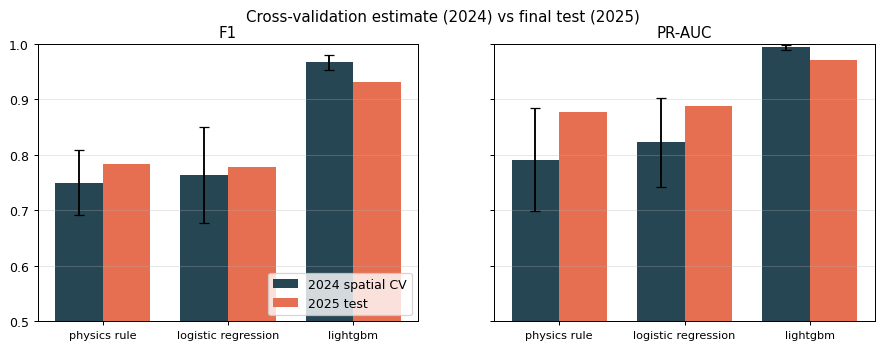
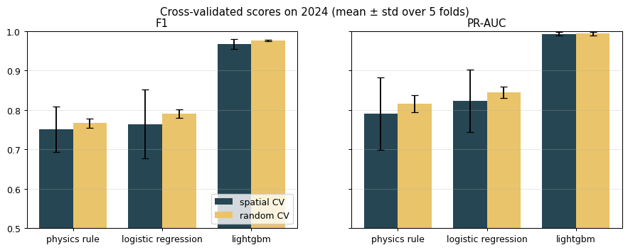
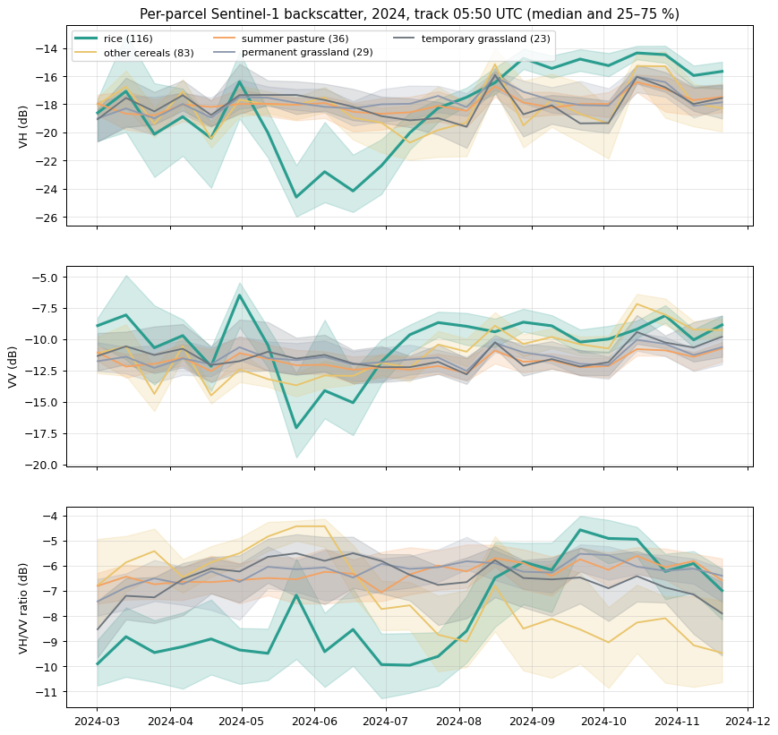

# rice-sar: rice-field detection from Sentinel-1 radar time series

Detects rice parcels from Sentinel-1 SAR (radar) time series, built with [eo-learn](https://eo-learn.readthedocs.io/).
Rice fields are flooded in spring, and open water reflects the radar pulse away from the satellite, so a rice parcel
first goes dark and then turns bright as the crop grows. The project turns that signature into a parcel-level
rice / not-rice classifier and evaluates it honestly: with spatially blocked cross-validation in one season and a
final test on the next season.

The first case study is the **Camargue** (Rhône delta, France), which grows nearly all French rice. Everything
region-specific lives in one config file (`configs/camargue.toml`), so the workflow can be pointed at other regions
that have public parcel labels.

**Status:** complete for the Camargue: feasibility (notebook 01), 2024 training dataset (02), model selection with
spatial cross-validation and an ablation (03), and a final test on the untouched 2025 season (04).

## Results

### Final test: model trained on 2024, tested once on 2025

The model, threshold, features and settings were frozen before 2025 was looked at.

| | 2024 spatial CV | **2025 test** (95 % CI, block bootstrap) |
|---|---|---|
| F1 | 0.967 ± 0.013 | **0.931** (0.913–0.946) |
| precision | 0.975 | 0.944 |
| recall | 0.960 | 0.918 |
| PR-AUC | 0.994 | 0.971 |



- **The model carries over to a new season, with a real but modest drop** (the 2025 interval excludes the CV estimate).
  Cross-validation within one year measures *new places*, not a *new year*; that's why a separate test season was kept.
- **Why:** the 2025 season came 2–3 weeks earlier and the rice peaked about 1 dB lower. LightGBM partly learned the exact 2024
  dates. The simpler references (physics rule, logistic regression; F1 0.78 on 2025) use timing-tolerant window
  features and held up, but stay far behind.
- **Next version:** train on several seasons and/or add timing-tolerant features (e.g. align each parcel on its own flooding
  date), then test on a new untouched season.

### Cross-validation on 2024 (13,613 parcels, 1,524 rice, 5 folds of whole 5 km blocks)

| model | F1 | precision | recall | PR-AUC |
|---|---|---|---|---|
| majority ("never rice", 89 % accurate) | 0.00 | 0.00 | 0.00 | 0.11 |
| physics rule (flood dip + summer rise) | 0.75 ± 0.06 | 0.74 | 0.76 | 0.79 |
| logistic regression (6 physics features) | 0.76 ± 0.09 | 0.83 | 0.71 | 0.82 |
| **LightGBM (features + 12-day time series)** | **0.97 ± 0.01** | **0.98** | **0.96** | **0.99** |



- A random split (neighbouring parcels in both training and test) scores 0.01–0.03 F1 higher, with a much smaller spread.
  The spatially blocked numbers above are the honest ones.
- The physics rule learns the same thresholds in every fold (flood VH below −23.5 dB, rise above 8.5 dB), but two summary numbers
  aren't enough over the whole delta.
- **Ablation: is it the model or the inputs?** (spatial-CV F1)

  | | 6 physics features | + full 12-day time series |
  |---|---|---|
  | logistic regression (linear) | 0.76 ± 0.09 | 0.94 ± 0.01 |
  | LightGBM (trees) | 0.79 ± 0.09 | 0.97 ± 0.01 |

  Most of the gain comes from the inputs: *when* the dip, rise and harvest happen over the season. The more flexible model adds
  about 0.03 on top.
- Remaining errors: other irrigated summer crops (maize, sorghum, durum wheat) as false alarms, and lower recall for rice parcels
  under 2 ha (0.86).
- LightGBM was chosen by a rule fixed before looking at the results (the simplest model within one std of the best F1). It is
  frozen in `outputs/` for the 2025 test (results above).

### Feasibility (one 10 km square)



In a 10 × 10 km test square (2024 season, 355 parcels), the rice parcels drop to about −24 dB VH while flooded
(May–June) and rise to about −15 dB at the peak of growth (August–October). Other crops stay at about −17 to −20 dB.
A single threshold on "lowest VH during flooding" already finds 90 % of rice parcels with 86 % precision. Those numbers
are on the data the threshold was picked from, so they are optimistic. The false alarms are mostly melon and tomato
fields, which are also dark in spring but don't show the summer rise. Details are in
`notebooks/01-feasibility.ipynb`.

## Method

- **Labels:** the French RPG (Registre Parcellaire Graphique), the parcels farmers declare each year for EU CAP subsidies,
  with their crop. Rice = crop code `RIZ`. These are declarations, so a little label noise is expected.
- **Satellite data:** Sentinel-1 GRD, IW mode, VV + VH, one descending track (05:50 UTC, so all dates share one
  viewing angle), sigma0, orthorectified, 20 m. Downloaded
  through the free Copernicus Data Space Ecosystem with eo-learn (`SentinelHubInputTask` → `VectorToRasterTask` →
  `SaveTask`, run by `EOExecutor`).
- **Per-parcel time series:** mean backscatter of all pixels inside each parcel (shrunk by 20 m to drop mixed edge
  pixels), averaged in linear units and then converted to dB.
- **Features:** the series on a fixed 12-day grid (so years with different revisit give the same columns), plus six
  physics features (lowest VH while flooded, highest VH at peak growth, the rise between them, VV and VH/VV equivalents).
  Parcels observed on fewer than 75 % of passes (mostly under 0.5 ha) are left out; they hold 0.2 % of the rice area.
- **Models and validation:** majority class, a physics rule with thresholds learned per fold, logistic regression and
  LightGBM. Training uses 2024 with spatially blocked cross-validation (5 km blocks), so that neighbouring parcels can't
  leak information between folds. The **2025 season is the untouched test set**: it is not looked at while designing
  the method.

## Reproduce

Requirements: Python 3.9 (eo-learn 1.5.7 supports 3.8–3.11) and a free
[Copernicus Data Space](https://dataspace.copernicus.eu/) account with an OAuth client for Sentinel Hub.

```bash
python -m venv .venv
# Windows: .venv\Scripts\activate    Linux/macOS: source .venv/bin/activate
pip install -r requirements.txt
cp .env.example .env        # then fill in your CDSE OAuth client id and secret

python scripts/download_labels.py --year 2024
python scripts/download_labels.py --year 2025
python scripts/download_s1.py --year 2024 --area feasibility
python scripts/check_tracks.py --year 2024          # optional: which track covers the area
python scripts/download_s1.py --year 2024 --area full
python scripts/download_s1.py --year 2025 --area full   # the test season: download, but don't look until notebook 04
```

Then run the notebooks in `notebooks/` in order, from the `notebooks/` folder.

**Cost:** the feasibility square uses about 46 Process API requests and about 120 processing units. The full area (33 squares,
one track) uses 759 requests and about 1,900 processing units for 2024 (Sentinel-1A only), and 1,386 requests and about 3,500 processing
units for 2025 (Sentinel-1A + 1C). The free CDSE quota is 10,000 of each per month.

## Limitations

- One region (the Camargue) and two seasons. How well it transfers to other rice systems is untested (see below).
- Labels are farmers' declarations (RPG), not field checks. Some "errors" may be label noise.
- Only parcels large enough to measure with 20 m radar pixels after a 20 m edge buffer (most of them ≥ 0.5 ha, 99.8 % of the
  rice area) are classified.
- 2025 mixes two satellites (S1A + S1C, from late March), while 2024 had one. The fixed 12-day grid makes the inputs comparable,
  but it is part of the year-to-year shift.

## Project structure

```
configs/          one config per study region (area, season, Sentinel-1 settings, label source)
notebooks/        analysis, run in numbered order
src/ricesar/      reusable code: config + credentials, labels, eo-learn download workflow, per-parcel features, models
scripts/          command-line entry points (data download, track check)
data/             not committed; re-created by scripts/
outputs/          not committed; models, large rasters
reports/figures/  figures shown in this README
```

## Using it for another region

1. Copy `configs/camargue.toml` and set the area, the season months and the orbit direction.
2. Add a label adapter in `src/ricesar/labels.py` for the region's public parcel data (for example national LPIS/GSA
   declarations, [EuroCrops](https://github.com/maja601/EuroCrops), or the USDA Cropland Data Layer).
3. Expect **domain shift**: other calendars, transplanted or rainfed rice (no spring flood), several seasons per year,
   and fields smaller than a few 20 m pixels all change the signature. A model trained in the Camargue has to be
   validated on local labels, and usually retrained.

## How AI was used

This project was built together with an AI coding assistant.

- **The author** came up with the idea (detecting rice with Sentinel-1 from the spring flooding and the rise in
  backscatter as the crop grows) and chose the Camargue as the study area. The author decided the evaluation design: a
  binary per-parcel target, spatially blocked cross-validation on 2024, and a single final test on the untouched 2025
  season. The author made the other decision points too (using one orbit track, adding the ablation), approved a plan
  before each phase and reviewed the results after it.
- **The assistant** set out the options at each decision point, wrote the code, the notebooks and this README, looked up
  data sources and API details, and ran the downloads and notebooks.

Every result shown here comes from code that was run end to end, and the reasoning behind each choice is written into the
notebooks.

## Data sources & licenses

- **Sentinel-1 GRD**: Copernicus Sentinel data 2024–2025, processed by ESA, accessed through the
  [Copernicus Data Space Ecosystem](https://dataspace.copernicus.eu/). Free, full and open access under the
  [Copernicus data policy](https://sentinels.copernicus.eu/documents/247904/690755/Sentinel_Data_Legal_Notice).
- **RPG (Registre Parcellaire Graphique)**, IGN / ASP, editions 2024 and 2025, through the IGN Géoplateforme WFS
  (`https://data.geopf.fr/wfs/ows`). Licence Ouverte / Etalab 2.0.

## License

MIT, see `LICENSE`.
